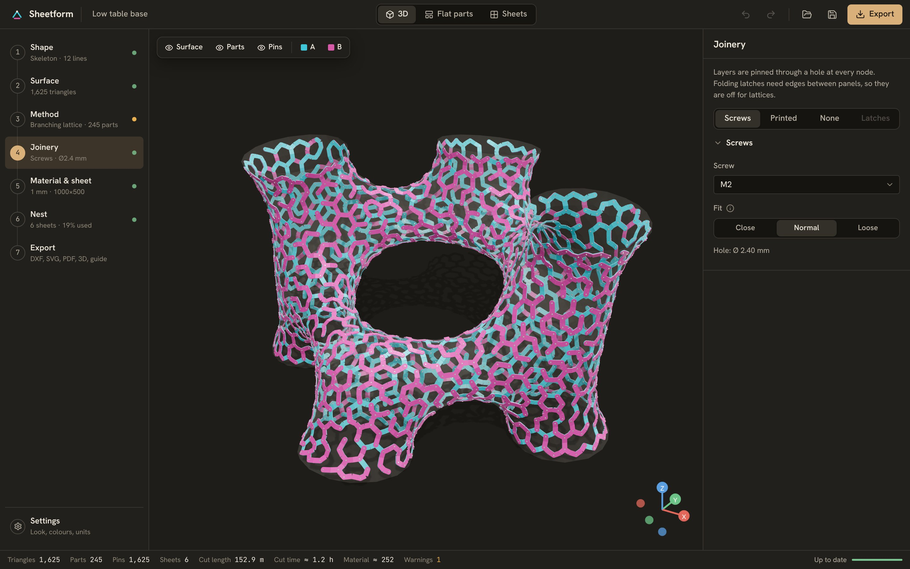
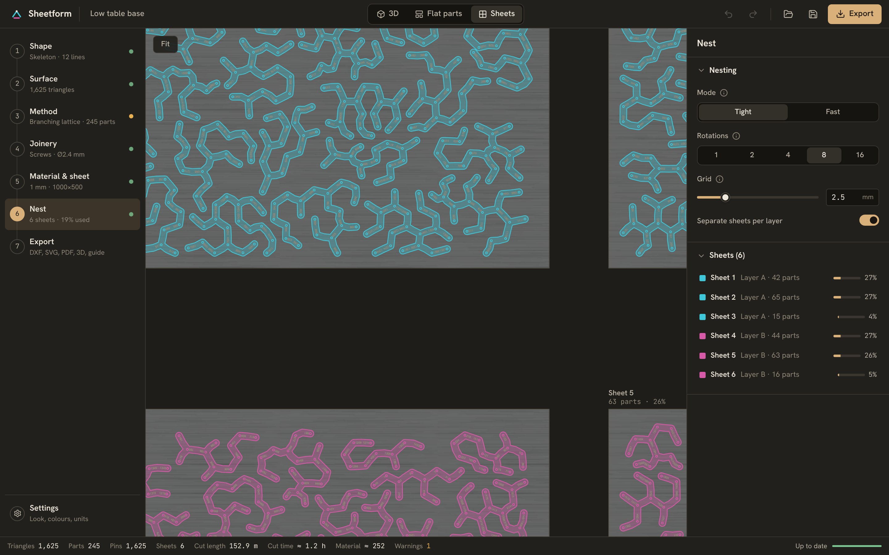
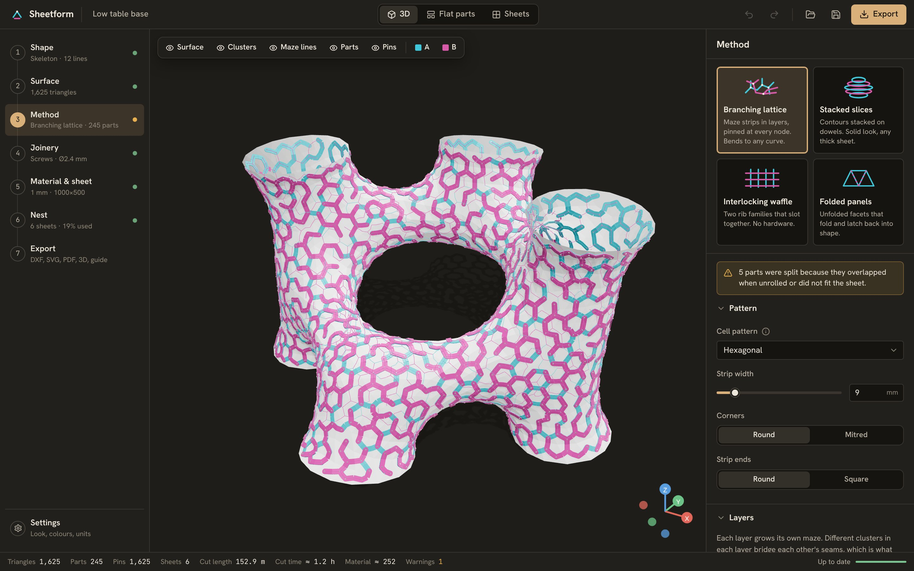

<p align="center">
  
</p>

<h1 align="center">Sheetform</h1>

<p align="center">
  Turn any 3D shape into flat sheet parts you can laser-cut, CNC-cut, number and assemble.<br/>
  Runs in the browser, and as a desktop app for Windows and macOS.
</p>

<p align="center">
  
</p>

Sheetform takes a shape — modelled in the app or imported — and rebuilds it from parts cut out of flat sheet material. It produces the cut file, the flat parts, the assembled 3D model, a parts list, an assembly guide and printable connectors. Every step of the process has its own controls.

It started from the "organic shape to fabrication" workflow, usually built as a large Grasshopper definition (SubD → Kangaroo → clusters → Kruskal maze → strips → pinned layers → unroll → nest), and makes it a standalone tool with three more construction methods.

## Features

**Shape**
- **Skeleton lines → body**: draw a graph of lines with a radius per node, and it is wrapped in a smooth tube body (MultiPipe-style smooth union). Tube ends can be left open.
- **Primitive library**: sphere, torus, rounded box, capsule, vase, blob, twisted tower, saddle, lampshade, trefoil knot. Each has three shape sliders.
- **Sculpt**: draw, inflate, grab, smooth, flatten, pinch and erase brushes, with X-mirroring. Every stroke can be undone.
- **Import**: STL, OBJ, PLY, GLB/GLTF and Rhino **3DM**, with a choice of file units.

**Surface**
- Size (W/D/H, proportional or free), rotation, sit-on-floor, and planar cuts to make openings.
- **Isotropic remeshing** to a target triangle count (split, collapse, flip, tangential relax, project).
- **Relax**: *minimal surface* (soap film between the open rims, like Kangaroo) or *smooth* (Taubin, no shrinking).

**Four construction methods**

| Method | What you get | Joinery |
|---|---|---|
| **Branching lattice** | The surface is split into clusters, and a maze (spanning tree) grows inside each one. Each maze becomes one strip part. Two or more layers with different clusters are pinned together through a numbered hole at every node. | Screws, printed pins/hubs/spacers, plain holes |
| **Stacked slices** | Contour slices along X, Y or Z, solid or hollow. Dowel holes run through every slice, and each slice has the outline of the next one engraved on it. | Screws/rods, printed pins, plain holes |
| **Interlocking waffle** | Two families of ribs with half-slots, fit clearance and lead-in chamfers. Each slot is labelled with its mating rib. Ribs can be hollow, keeping a post at every slot. | Slots, printed cross clips |
| **Folded panels** | A papercraft unfold of a faceted version of the shape. Fold lines are scored (mountain/valley) or perforated, and matching cut edges are numbered. | **4 integral latches** (tab & slot, arrowhead, hook, dovetail), glue tabs, screw holes, printed angle brackets |

Lattice controls: cell pattern (hexagonal / triangular / square / star), number of layers, clusters per layer, maze algorithm (Kruskal, Prim, backtracker, Wilson, radial), grain bias, seed, strip width, corner and end style, stack direction, pin density, engraved hole numbers and part names, and auto-splitting of parts that would overlap themselves or not fit the sheet.

**Joinery**
- **Screws**: ISO 273 clearance holes for M2–M6, US #4–#8 and pop rivets, with close, normal or loose fit, or a custom diameter.
- **3D printed parametric connectors** (built with Manifold, so the meshes are watertight and ready to print): snap pin/rivet, **hollow screw** (threaded sleeve and nut with an open centre), spacer, **node hub** (one per node, with arms at the real strip angles), and **angle bracket** (at the real panel angle; cross clips for waffles).
- **None**: plain holes of any diameter.
- **Folding latches**: four types, each fully parametric (width, depth, clearance, flare angle, count per edge).

**Material, sheet, nesting**
- Material presets from stainless steel to card stock, each with thickness, kerf, minimum bend radius, price and cut speed.
- Sheet presets or a custom size, margin, part spacing, and optional kerf compensation in the exported files.
- **Tight nesting** fills sheets on a raster, so irregular parts interlock and small parts can sit inside the holes of big ones. **Fast nesting** uses MaxRects on bounding boxes. Rotations can be locked to keep the grain direction.

**Exports**
- **DXF R12** cut files, one per sheet or all in one, with layers `CUT_INNER` (cut first), `CUT_OUTER`, `ENGRAVE`, `SCORE`, `SHEET`. Text is single-stroke (Hershey), so it engraves cleanly.
- **SVG** at 1:1 mm (red = cut, blue = engrave, green = score) and **PDF** at true scale.
- **Flat parts** (unrolled, not nested) as SVG or DXF.
- **Assembled 3D model** as STL, OBJ, GLB or 3MF. The **original base model** and the **working surface** can also be exported.
- **Assembly guide** PDF: a cover render, the steps for the chosen method, every sheet with part labels, and a page entry for every part with its outline, pin numbers and a render showing where it goes.
- **Parts list & stats** as CSV or JSON: sizes, cut length, sheet positions, estimated cut time and cost.
- **Printable connectors** as a zip of STL files plus a print list.
- **Project file** (`.sheetform`), and a single **export everything** zip.

**Interface**
- The left rail follows the build order and shows each step's live result. The status bar shows parts, pins, sheets, cut length, cut time and material cost.
- Click a part in 3D, in the flat view or on a sheet, and it is selected in every view.
- **Three looks**: *Model shop*, *Pattern tissue* and *Drafting*, each in dark and light. Each look has its own part and layer colours, which you can change in Settings.
- Undo/redo for every change, autosave, and millimetres or inches.
- Heavy geometry runs in a Web Worker, so the interface stays responsive. Each pipeline stage is cached, so changing the sheet size never re-runs the remesher.

<p align="center">
  
  
</p>

## Quick start (web)

Requires Node.js 20 or newer.

```bash
npm install
npm run dev        # http://localhost:5173
```

```bash
npm run build      # static site in dist/
npm run preview    # serve the production build
npm test           # geometry tests (Vitest)
npm run typecheck
```

The build is a static site with relative paths, so `dist/` can be hosted anywhere. Pushing to `main` deploys it to **GitHub Pages** through `.github/workflows/pages.yml`. To turn this on, go to *Settings → Pages* in the repository and set *Source: GitHub Actions*.

## Desktop app (Windows & macOS)

The desktop app is the same front end in a [Tauri 2](https://tauri.app) shell, which adds native save and open dialogs. Installers are small (a few MB) because they use the system web view.

Prerequisites: [Rust](https://rustup.rs) (stable), plus the platform tools listed in the [Tauri prerequisites](https://tauri.app/start/prerequisites/): Xcode Command Line Tools on macOS, and the MSVC Build Tools and WebView2 on Windows (WebView2 is preinstalled on Windows 10/11).

```bash
npm run desktop:dev     # run the desktop app with hot reload
npm run desktop:build   # build an installer for the current OS
```

Output goes to `src-tauri/target/release/bundle/` (`.msi` and `.exe` on Windows, `.dmg` and `.app` on macOS).

**Automated releases**: push a tag such as `v0.2.0`. `.github/workflows/release.yml` then builds Windows installers and a universal macOS `.dmg`, and attaches them to a draft GitHub release. Builds are unsigned by default. To sign and notarise on macOS, add the `APPLE_*` secrets listed in the workflow.

## How the lattice works

| Step | In Sheetform |
|---|---|
| 1. Lines → SubD | **Shape → Skeleton**: a smooth union of tapered capsules, polygonised with Surface Nets. Open leaf ends are cut flat at the node. |
| 2. Mesh + Kangaroo | **Surface**: isotropic remeshing to a triangle count, then *Relax → Minimal* pulls the skin taut between the rims. |
| 3. Clusters | **Method → Layers → Clusters**: geodesic k-means (farthest-point seeds plus Lloyd iterations over Dijkstra regions) on the pattern graph. |
| 4. Maze lines | A spanning tree inside each cluster (Kruskal by default). For the hexagonal pattern, the nodes are triangle centres and the lines cross each shared edge at its midpoint. |
| 5. Strips | Each tree is **unrolled exactly**: segment lengths and in-surface angles (geodesic turning) are kept, so a thin strip bent onto the surface follows the lines. The outline is a round-joined offset of the 2D tree. |
| 6. Layer 2 + pins | Every layer uses the same nodes but different clusters and trees, so layer B's strips run across layer A's seams. Each node gets one pin through all layers. |
| 7. Unroll | Parts that would overlap themselves, or not fit the sheet, are split at the edge that best balances the two halves. Every hole is engraved with its pin number, and the part name runs along its longest straight run. |
| 8. Nest | Raster bottom-left fill with up to 16 rotations, grouped by layer. |

More detail is in [docs/ARCHITECTURE.md](docs/ARCHITECTURE.md).

## Project structure

```
src/
  core/                 Pure TypeScript geometry, no DOM. Runs in the worker and in tests.
    math/               vectors, matrices, seeded RNG, hashing
    mesh/               topology, clipping, remeshing, relaxing, slicing, BVH projection
    modeling/           Surface Nets, skeleton bodies, primitives
    graph/              surface graphs (hex/tri/quad/star), clustering, spanning trees
    lattice/ slices/ waffle/ folded/   the four construction methods
    joinery/            hole sizes, latch shapes
    connectors/         printed connectors (Manifold WASM)
    polygon/            Clipper wrapper: offsets, booleans, islands
    nest/               raster and MaxRects nesting
    text/               Hershey single-stroke font
    export/             sheet geometry, DXF and SVG writers
    pipeline.ts keys.ts params.ts defaults.ts presets.ts
  workers/              geometry worker (Comlink), stage cache
  state/                Zustand stores: project (undoable), UI, results, engine, assets (IndexedDB)
  viewport/             React Three Fiber scene, 2D sheet canvas, sculpting, skeleton editor
  ui/                   layout, inspector panels, controls (Radix), theme and shortcuts
  io/                   import (STL/OBJ/PLY/GLB/3DM), exports (PDF, 3D, guide), project files
  platform/             browser vs. Tauri file saving
  styles/ themes/       design tokens for the three looks, dark and light
src-tauri/              desktop shell (Rust, Tauri 2)
tests/                  Vitest geometry tests
```

## Tech

Vite · React 19 · TypeScript · Three.js / React Three Fiber · Zustand + zundo · Comlink Web Workers · Clipper (polygon offsets) · Manifold 3D (WASM booleans) · three-mesh-bvh · rhino3dm · jsPDF · fflate · Radix UI · Tauri 2.

## Keyboard shortcuts

| Keys | Action |
|---|---|
| `1`–`7` | Jump to a build step |
| `F` | Frame the view |
| `Esc` | Clear the selection |
| `Ctrl/⌘ Z`, `Ctrl/⌘ Shift Z` | Undo, redo |
| `Ctrl/⌘ S`, `Ctrl/⌘ O` | Save or open a project |
| `Alt` while sculpting | Reverse the brush |

## Known limits

- The lattice assumes a thin, bendable sheet (metal, thin plywood, plastic, card). The app warns when the material cannot bend.
- In the 3D view and 3D exports, lattice strips are drawn as flat segments and discs: right for previews and renders, but not a single fused solid.
- Nesting is a fast raster heuristic, not an optimal nester. A finer grid packs tighter but takes longer.
- Rhino 3DM import uses the render meshes stored in the file. If a Brep has none, run `_Mesh` in Rhino or export STL/OBJ.
- Node hubs are unique per node, so a large lattice exports a large zip.

## Licence

MIT. See [LICENSE](LICENSE).

Acknowledgements: the Hershey fonts (public domain), [Clipper](https://www.angusj.com/clipper2/), [Manifold](https://github.com/elalish/manifold), [three.js](https://threejs.org), [three-mesh-bvh](https://github.com/gkjohnson/three-mesh-bvh), and the computational design community whose Grasshopper workflows inspired this tool.
