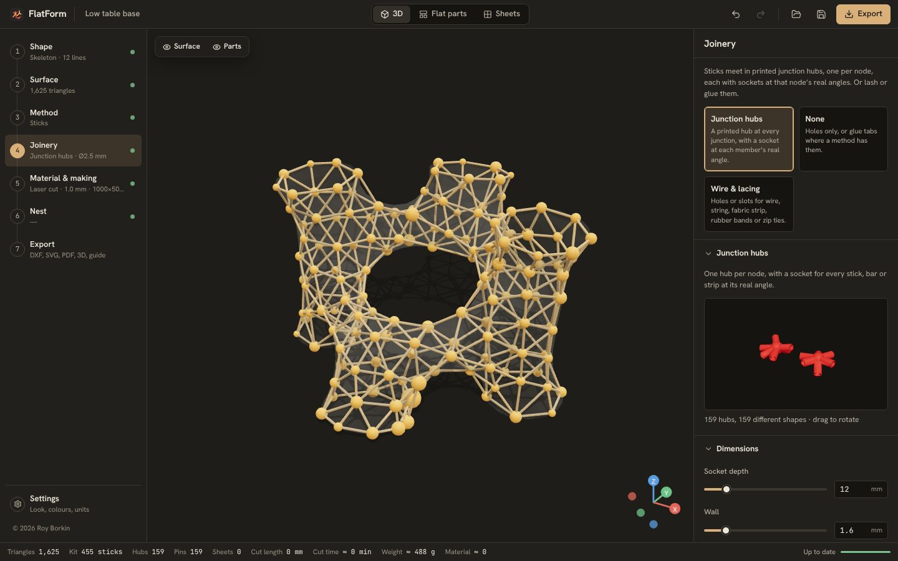
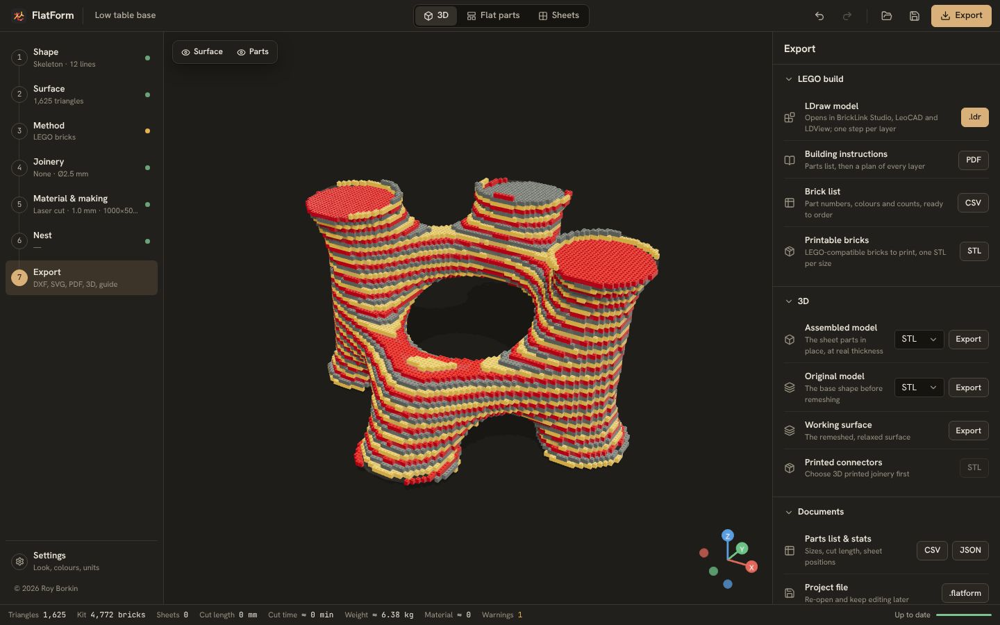

<!-- FlatForm — © 2026 Roy Borkin · royborkin@gmail.com · https://royborkin.github.io/ · All rights reserved -->
<p align="center">
  
</p>

<h1 align="center">FlatForm</h1>

<p align="center">
  <b>The slicer for 2D fabrication.</b><br/>
  Slice any 3D model into flat parts you can laser-cut, CNC-route or print flat, then build it back in 3D.<br/>
  Runs in the browser, and as a desktop app for Windows and macOS.
</p>

<p align="center">
  <a href="https://royborkin.github.io/FlatForm/"><b>Open the web app</b></a> ·
  <a href="https://github.com/royborkin/FlatForm/releases/latest"><b>Download for Windows / macOS</b></a>
</p>

<p align="center">
  © 2026 <a href="https://royborkin.github.io/">Roy Borkin</a> · <a href="mailto:royborkin@gmail.com">royborkin@gmail.com</a> · All rights reserved
</p>

<p align="center">
  
</p>

A 3D-printer slicer takes a model and turns it into layers and toolpaths that one machine can build. **FlatForm does the same for 2D manufacturing.** It takes a model — made in the app or imported — and slices it into flat parts that a laser cutter, a CNC router, a paper cutter or a 3D printer printing flat can make, then works out how those parts join, numbers them, nests them on your sheets and writes the files your machine reads.

Where a 3D-print slicer has layer height, infill and supports, FlatForm has the **construction method** (how the model is broken into flat parts: slices, waffles, unfolded panels, strips, bars, triangles…), the **joinery** (how the parts hold together) and the **making** settings (laser, CNC or 3D print). Every step has its own controls, and the result is the cut file, the flat parts, the assembled 3D model, a parts list, an assembly guide and any printed connectors.

It started from the "organic shape to fabrication" workflow, usually built as a large Grasshopper definition (SubD → Kangaroo → clusters → Kruskal maze → strips → pinned layers → unroll → nest), and makes it a standalone tool with **fourteen construction methods**, **twelve kinds of joinery** and three ways of making the parts.

## Features

**Shape**
- **Skeleton lines → body**: draw a graph of lines with a radius per node, and it is wrapped in a smooth tube body (MultiPipe-style smooth union). Tube ends can be left open.
- **Primitive library**: sphere, torus, rounded box, capsule, vase, blob, twisted tower, saddle, lampshade, trefoil knot. Each has three shape sliders.
- **Sculpt**: draw, inflate, grab, smooth, flatten, pinch and erase brushes, with X-mirroring. Every stroke can be undone.
- **Import**: STL, OBJ, PLY, GLB/GLTF and Rhino **3DM**, with a choice of file units.

**Surface**
- Size (W/D/H, proportional or free), rotation, sit-on-floor, and planar cuts to make openings.
- **Isotropic remeshing** to a target triangle count (split, collapse, flip, tangential relax, project).
- **Relax**: *minimal surface* (soap film between the open rims, like Kangaroo) or *smooth* (Taubin, no shrinking).

**Fourteen construction methods**, in four families

| Family | Method | What you get |
|---|---|---|
| Surface | **Branching lattice** | The surface is split into clusters and a maze grows inside each one; each maze is one strip part. Two or more layers with different clusters are pinned together through a numbered hole at every node. |
| Frames | **Mesh lines** | Every edge of the mesh becomes a flat bar, standing on edge (the matchstick-frame look) or lying flat. Bars are rounded to a length step so equal ones can be batch-cut; node hubs can be printed with arms at the real angles. |
| Frames | **Triangles** | The surface is rebuilt from a few repeated triangle shapes: edge lengths are clustered into classes, the mesh is relaxed toward them (position-based springs projected to the surface), and each face is cut as the ideal triangle of its classes. Solid panels or open frames, with gap and corner trim. |
| Frames | **Sticks** | Every edge becomes a stick: toothpicks, bamboo skewers, wood dowels, carbon or aluminium tubes, square profiles, or **laser-cut flat strips**. Sticks are rounded to a length step, lettered A, B, … and packed into stock lengths for a cut list; each node gets a printed **junction hub** with a socket at every stick's real angle, and identical hubs share one file. |
| Frames | **LEGO bricks** | The shape is rebuilt from real LEGO bricks or plates on the 8 mm stud grid: solid or hollow with a set wall, staggered joints, the brick sizes you own, and colour by one colour, layers or height bands. You get a brick list with LDraw/BrickLink part numbers, an **LDraw model** (one step per layer), layer-by-layer instructions and printable LEGO-compatible bricks. |
| Sections | **Stacked slices** | Contour slices along X, Y or Z, solid or hollow, on dowels, with the next slice engraved on each one. |
| Sections | **Layers** | Spaced layers in **any direction** (azimuth / tilt) or fanned **along a curve** you draw. Rods run through the longest run of layers they can; **3D-printed spacers** (round, square, hex or star, any size) hold the gaps, grouped by length. Hollow layers keep a hub and spokes around every rod. |
| Sections | **Interlocking waffle** | Two families of ribs with half-slots, fit clearance and lead-in chamfers, each slot labelled with its mating rib. |
| Sections | **Stacked layers** | Shapes stacked one on top of another, in four modes: **layered relief** (silhouettes from any view direction, like a topographic model), **solid stack** (touching sections through the whole shape), **laminated skins** (several surface skins glued and pinned over one another) and **nested shells** (offset copies of the shell, one inside the next). Held by bend tabs, rods, pins or any seam joinery. |
| Sections | **Classic slot model** | The classic laser-cut model in three styles: **grid** (two rib families in any plane, rotatable), **revolve** (profiles fanned around the axis, sliding into open rings) and **along a curve** (ribs square to a spine curve, on one to three spines). Slots open the same way for every pair, so parts slide together. |
| Folded | **Folded panels** | A faceted unfold; folds scored, perforated, cut with **bend relief** (for bending sheet metal by hand), cut as **living hinges** (rigid board bends into a curve at each fold) or cut as Flaticulation joints; cut edges numbered and joined. |
| Folded | **Paper-craft** | Pepakura-style pieces with glue flaps (alternate, one side, both or none; trapezoid, rounded or triangle), mountain/valley fold lines, edge numbers and piece names. |
| Folded | **Minimal joinery** | A few large pieces of **flexible** sheet (felt, fabric, leather, thin plastic). Each piece is flattened in one go with least-squares conformal maps, so it may stretch a little instead of being cut up; tubes and rings are split until every piece lies flat. Seams are laced. |
| Folded | **Flex hinges** | The same few large pieces in **rigid** sheet (plywood, MDF, acrylic): every fold that bends gets a band of living hinge in one of **12 patterns**, either one direction per piece or following each fold (curved laser-bent wood). |

**Bending patterns**
- **Bend relief** (folded panels), 6 patterns: hand-bend slots with angled tabs (after SendCutSend's hand-bend guide: slots about 0.5–0.7× the thickness, tabs at least the thickness, about six slots per bend), wave slots, round-end slots, holes, staggered slots, and slots with crack-stop holes. Optional round or square relief where a bend meets an edge or corner.
- **Living hinges** (flex hinges and folded panels), 12 patterns: straight lines, rectangles, round-end slots, dog-bones, wave, zig-zag, chevron, serpentine, diamond lattice, honeycomb, crosses and triangles. Cut length, bridge, row spacing and slot width; each pattern is drawn by the same code that cuts it.

**Joinery** (each method offers the kinds that make sense for it)
- **Screws**: ISO 273 clearance holes for M2–M6, US #4–#8 and pop rivets, close/normal/loose fit, or a custom diameter.
- **3D printed parametric connectors** (Manifold, watertight): snap pin, **hollow screw** with an open centre, spacer (and shaped **layer spacers**), **node hub** with arms at the real angles, **angle bracket** at the real panel angle, cross clips for waffles.
- **None**: plain holes of any diameter, or glue tabs where a method has them.
- **Folding latches**: tab & slot, arrowhead, hook and dovetail, fully parametric.
- **Wire & lacing**: holes or slots for metal wire, string, fabric strip, rubber bands or zip ties; running, cross, whip or notch stitch; hole size, slot length, pitch and edge distance.
- **Finger joints**: box joints along every seam, with depth corrected for the real angle between the parts. *Unique* and *symmetric* patterns code each seam so only the right parts fit (after FoolProofJoint, CHI ’22).
- **Junction hubs**: a printed hub wherever parts meet at a point, with a round, square or slot socket (sticks, bars, strips) or a fork (panel corners, which are cut back to fit) at each member's real angle. Works with sticks, mesh lines, lattice nodes, triangles, folded panels, flex hinges and shells. Three versions:
  - **Solid**: one piece with a round core; the strongest, but downward sockets need supports.
  - **No supports**: one piece that prints without supports. Each sleeve stands on a fin that tapers at 45° to the bed, round sockets are 45° diamonds, stick hubs print upside down when most arms point down, and panel corners rest on shelves with a screw hole (the panels get matching holes).
  - **Flat, bends**: a thin star-shaped plate whose arms bend along marked lines to each member's angle: panel arms fold about the line where the plate meets the panel, so they land flat on it and screw on; stick arms tie on through two slots. Printed thin in PETG or TPU with a V-groove at each bend, or cut from bendable sheet with the bends scored and the angles engraved.
- **Crossing clips**: printed caps for each end of a slotted crossing (waffle, classic), shaped for that crossing's angle, or **collars** that grip the rod on both sides of every layer (slices, layers, stacks).
- **Cardboard connectors**: printed U-channels that grip two sheet edges at the seam's angle, one file per angle; panels stop short of the seam and engraved marks show where each connector goes. After the open-source cardboard connector systems on Printables and MakerWorld.
- **LEGO Technic**: Ø4.8 mm pin holes (or cross-shaped axle holes) on the 8 mm stud pitch, so parts join with real Technic pins and axles.
- **Bend tabs**: tabs that pass through a slot in the next layer or panel and are bent over, with fold-under length, bend radius and score lines. For any sheet in all layer methods and along folded seams; the app warns on brittle materials.
- **Flaticulation**: folds are cut right through and T-patterns along them clutch the two sides at their exact angle (Zheng et al., UIST ’22). Articulated or detent joints; neck and head width, edge coverage, stiffness, breakaway bridges, and kerf calibration (K, α) from the paper's Table A.1.

Every joinery panel shows a live preview drawn by the same code that cuts the parts.

**Making: laser, CNC or 3D print**
- **Laser cut**: passes, engrave speed, and optional **holding bridges** that leave small uncut gaps in each outline.
- **CNC**: tool diameter, **dog-bone or T-bone corner reliefs** on every inside corner, holding tabs, feed and depth per pass; warns when the tool is wider than a slot.
- **3D print**: the sheet becomes the **print bed** (presets for common printers or a custom size); parts are nested per plate and exported as **STL or 3MF plates**; filament, layer height, nozzle, infill, brim and flow.
- **Weight** for every material (density in kg/m³; filament density and infill for prints) and time per process, shown live in the status bar and the parts panel.

**Material, sheet, nesting**
- Material presets from stainless steel to card stock, felt, leather and PLA, each with thickness, kerf, minimum bend radius, density, price and cut speed.
- Sheet presets or a custom size, margin, part spacing, and optional kerf compensation in the exported files.
- **Tight nesting** fills sheets on a raster, so irregular parts interlock and small parts can sit inside the holes of big ones. **Fast nesting** uses MaxRects on bounding boxes. Rotations can be locked to keep the grain direction.

**Exports**
- **DXF R12** cut files, one per sheet or all in one, with layers `CUT_INNER` (cut first), `CUT_OUTER`, `ENGRAVE`, `SCORE`, `SHEET`. Text is single-stroke (Hershey), so it engraves cleanly. Holding bridges and CNC tabs break the outer outlines.
- **SVG** at 1:1 mm (red = cut, blue = engrave, green = score) and **PDF** at true scale.
- **Flat parts** (unrolled, not nested) as SVG or DXF.
- **Assembled 3D model** as STL, OBJ, GLB or 3MF. The **original base model** and the **working surface** can also be exported.
- **Assembly guide** PDF: a cover render, the steps for the chosen method, every sheet with part labels, and a page entry for every part with its outline, pin numbers and a render showing where it goes.
- **Parts list & stats** as CSV or JSON: sizes, cut length, sheet positions, estimated cut time and cost.
- **Printable connectors and layer spacers** as a zip of STL files plus a print list.
- **Printed kits**: junction hubs, crossing clips and collars, or cardboard connectors as one STL per distinct shape, with a print list saying how many of each and where they go.
- **Stick cut list** (CSV): every length with its letter and count, and how many stock lengths to buy.
- **LEGO build**: an **LDraw model** (`.ldr`, opens in BrickLink Studio, LeoCAD and LDView), **building instructions** PDF with a parts page and a plan of every layer, a **brick list** CSV for ordering, and **printable LEGO-compatible bricks** (STL per size).
- **Print plates** (3D print) as STL or 3MF, one per bed.
- Every file carries the author credit: DXF comments, SVG metadata, PDF properties and footer, 3MF metadata, STL header.
- **Project file** (`.flatform`), and a single **export everything** zip.

**Interface**
- The left rail follows the build order and shows each step's live result. The status bar shows parts, pins, sheets, cut length, cut time and material cost.
- Click a part in 3D, in the flat view or on a sheet, and it is selected in every view.
- **Three looks**: *Model shop*, *Pattern tissue* and *Drafting*, each in dark and light. Part and layer colours default to the FlatForm palette (orange-red `#ee4036`, amber `#faaf40`, dark grey `#262626` and their tints) and can be changed per look in Settings; very deep colours are lifted automatically on dark grounds.
- Units: **mm, cm, m or inches**, shown and typed everywhere (files stay in millimetres).
- A splash while the app loads, and a progress card for anything slow: recomputes, exports, connectors and the guide.
- Undo/redo for every change, and autosave.
- Heavy geometry runs in a Web Worker, so the interface stays responsive. Each pipeline stage is cached, so changing the sheet size never re-runs the remesher.

<p align="center">
  
  
</p>
<p align="center">
  
  
</p>

## Quick start (web)

Requires Node.js 20 or newer.

```bash
npm install
npm run dev        # http://localhost:5173
```

```bash
npm run build      # static site in dist/
npm run preview    # serve the production build
npm test           # geometry tests (Vitest)
npm run typecheck
npm run notices    # refresh public/THIRD-PARTY-NOTICES.txt (also runs on build)
```

The build is a static site with relative paths, so `dist/` can be hosted anywhere. Pushing to `main` deploys it to **GitHub Pages** at <https://royborkin.github.io/FlatForm/> through `.github/workflows/pages.yml`. In the repository, *Settings → Pages → Source* must be **GitHub Actions** (with *Deploy from a branch*, Pages serves the raw source and the app cannot start).

**Step-by-step upload, Pages and release instructions: [docs/PUBLISHING.md](docs/PUBLISHING.md).**

## Desktop app (Windows & macOS)

The desktop app is the same front end in a [Tauri 2](https://tauri.app) shell, which adds native save and open dialogs. Installers are small (a few MB) because they use the system web view.

Prerequisites: [Rust](https://rustup.rs) (stable), plus the platform tools listed in the [Tauri prerequisites](https://tauri.app/start/prerequisites/): Xcode Command Line Tools on macOS, and the MSVC Build Tools and WebView2 on Windows (WebView2 is preinstalled on Windows 10/11).

```bash
npm run desktop:dev     # run the desktop app with hot reload
npm run desktop:build   # build an installer for the current OS
```

Output goes to `src-tauri/target/release/bundle/` (`.msi` and `.exe` on Windows, `.dmg` and `.app` on macOS).

**Automated releases**: raise the version (`npm run version:set 1.1.0`, or edit `package.json`, `src-tauri/tauri.conf.json` and `src-tauri/Cargo.toml`), commit and push (GitHub Desktop works), then run *Desktop release* from the Actions tab. `.github/workflows/release.yml` builds Windows installers (`.msi`, `-setup.exe`) and a universal macOS `.dmg` (Apple silicon + Intel) and attaches them to a draft release for you to publish. Builds are not code-signed: macOS builds are ad-hoc signed so they open via *Open Anyway*, and Windows shows a SmartScreen prompt (*More info → Run anyway*). Signing can be added later with the `APPLE_*` secrets listed in the workflow. Full walkthrough in [docs/PUBLISHING.md](docs/PUBLISHING.md).

## How the lattice works

| Step | In FlatForm |
|---|---|
| 1. Lines → SubD | **Shape → Skeleton**: a smooth union of tapered capsules, polygonised with Surface Nets. Open leaf ends are cut flat at the node. |
| 2. Mesh + Kangaroo | **Surface**: isotropic remeshing to a triangle count, then *Relax → Minimal* pulls the skin taut between the rims. |
| 3. Clusters | **Method → Layers → Clusters**: geodesic k-means (farthest-point seeds plus Lloyd iterations over Dijkstra regions) on the pattern graph. |
| 4. Maze lines | A spanning tree inside each cluster (Kruskal by default). For the hexagonal pattern, the nodes are triangle centres and the lines cross each shared edge at its midpoint. |
| 5. Strips | Each tree is **unrolled exactly**: segment lengths and in-surface angles (geodesic turning) are kept, so a thin strip bent onto the surface follows the lines. The outline is a round-joined offset of the 2D tree. |
| 6. Layer 2 + pins | Every layer uses the same nodes but different clusters and trees, so layer B's strips run across layer A's seams. Each node gets one pin through all layers. |
| 7. Unroll | Parts that would overlap themselves, or not fit the sheet, are split at the edge that best balances the two halves. Every hole is engraved with its pin number, and the part name runs along its longest straight run. |
| 8. Nest | Raster bottom-left fill with up to 16 rotations, grouped by layer. |

More detail is in [docs/ARCHITECTURE.md](docs/ARCHITECTURE.md).

## Project structure

```
src/
  core/                 Pure TypeScript geometry, no DOM. Runs in the worker and in tests.
    math/               vectors, matrices, seeded RNG, hashing
    mesh/               topology, clipping, remeshing, relaxing, slicing, BVH projection
    modeling/           Surface Nets, skeleton bodies, primitives
    graph/              surface graphs (hex/tri/quad/star), clustering, spanning trees
    lattice/ slices/ waffle/ folded/   the first four methods
    unfold/             unfold engine, LSCM flattening, panel builder; paper-craft, minimal, flex hinges
    sections/           interlocking sections in any orientation, guide curves; layers, classic
    frame/              mesh lines, triangles, sticks
    bricks/             LEGO voxel build and brick packing
    stack/              stacked layers: relief, solid, laminated skins, nested shells
    joinery/            hole sizes, latches, edge features (flaps, lacing, fingers), Flaticulation,
                        junction hubs (solid, support-free, flat), bend tabs, cardboard and LEGO seams,
                        living hinges and bend relief
    manufacturing/      CNC reliefs, print beds, weight and time estimates
    connectors/         printed connectors and kits: hubs, clips, cardboard connectors, bricks (Manifold WASM)
    polygon/            Clipper wrapper: offsets, booleans, islands
    nest/               raster and MaxRects nesting
    text/               Hershey single-stroke font
    export/             sheet geometry, DXF and SVG writers
    pipeline.ts keys.ts params.ts defaults.ts presets.ts
  workers/              geometry worker (Comlink), stage cache
  state/                Zustand stores: project (undoable), UI, results, engine, assets (IndexedDB)
  viewport/             React Three Fiber scene, 2D sheet canvas, sculpting, skeleton editor
  ui/                   layout, inspector panels, controls (Radix), theme and shortcuts
  io/                   import (STL/OBJ/PLY/GLB/3DM), exports (PDF, 3D, guide), project files
  platform/             browser vs. Tauri file saving
  styles/ themes/       design tokens for the three looks, dark and light
src-tauri/              desktop shell (Rust, Tauri 2)
tests/                  Vitest geometry tests
```

## Tech

Vite · React 19 · TypeScript · Three.js / React Three Fiber · Zustand + zundo · Comlink Web Workers · Clipper (polygon offsets) · Manifold 3D (WASM booleans) · three-mesh-bvh · rhino3dm · jsPDF · fflate · Radix UI · Tauri 2.

## Keyboard shortcuts

| Keys | Action |
|---|---|
| `1`–`7` | Jump to a build step |
| `F` | Frame the view |
| `Esc` | Clear the selection |
| `Ctrl/⌘ Z`, `Ctrl/⌘ Shift Z` | Undo, redo |
| `Ctrl/⌘ S`, `Ctrl/⌘ O` | Save or open a project |
| `Alt` while sculpting | Reverse the brush |

## Known limits

- The lattice assumes a thin, bendable sheet (metal, thin plywood, plastic, card). The app warns when the material cannot bend.
- In the 3D view and 3D exports, lattice strips are drawn as flat segments and discs: right for previews and renders, but not a single fused solid.
- Nesting is a fast raster heuristic, not an optimal nester. A finer grid packs tighter but takes longer.
- Rhino 3DM import uses the render meshes stored in the file. If a Brep has none, run `_Mesh` in Rhino or export STL/OBJ.
- Node hubs are unique per node, so a large lattice exports a large zip.
- Minimal joinery's flattening is conformal: angles are kept and areas may stretch a little, which suits felt and fabric but not paper. The app reports the worst stretch.
- Triangles approach their class lengths but rarely hit them exactly; panels are cut to the ideal size and the app reports the average and worst error.
- Flaticulation's kerf table was measured on 3 mm MDF; calibrate K and α for other boards.
- Junction hubs are made for each node's real angles. With **Share identical hubs** on, hubs whose angles agree to 1° print from one file, but a free-form shape usually has few repeats.
- The LEGO build checks that every brick is connected, but not that the model can stand under its own weight; hollow builds with thin walls can be fragile. Printable bricks fit real LEGO on a well-tuned printer; print a 2×2 first.
- Bend relief changes the bend radius and the flange length a little: do a test bend before cutting a whole kit.
- Flat hub arms for sticks fold straight up or down; where a stick is far from that plane the arm needs a slight twist (the app warns above 20°).
- Bend tabs crack in brittle sheet (acrylic, MDF): use them with metal, card, polypropylene or thin plywood.

## Licence

**All rights reserved.** © 2026 Roy Borkin · royborkin@gmail.com · https://royborkin.github.io/

The source is public so you can read it, but no licence is granted to copy, modify or redistribute it. You may use the official web app and release builds. See [LICENSE](LICENSE). Bundled open-source components keep their own licences; see [THIRD-PARTY-NOTICES.txt](public/THIRD-PARTY-NOTICES.txt).

Acknowledgements: Zheng, Li and Mueller, *Flaticulation: Laser Cutting Joints with Articulated Angles* (UIST 2022); Park et al., *FoolProofJoint* (CHI 2022); Lévy et al., *Least Squares Conformal Maps* (SIGGRAPH 2002); the Hershey fonts (public domain), [Clipper](https://www.angusj.com/clipper2/), [Manifold](https://github.com/elalish/manifold), [three.js](https://threejs.org), [three-mesh-bvh](https://github.com/gkjohnson/three-mesh-bvh), and the computational design community whose Grasshopper workflows inspired this tool.
